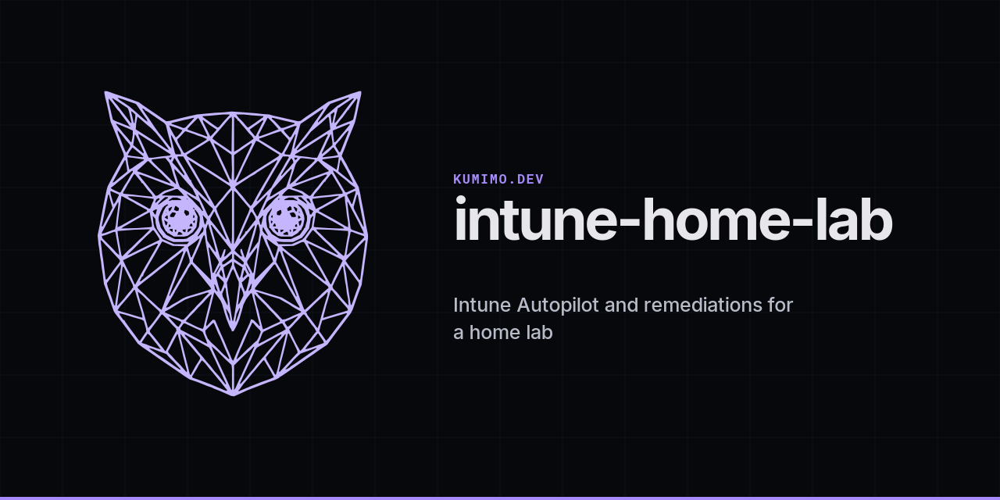

# intune-home-lab

Scripts and notes from a personal Microsoft Intune home lab. Aim is a small setup you can run again on a trial tenant while you learn Autopilot, remediations, Win32 apps, and clean Windows images.

These samples are for a home lab or a small business style trial. They are not a production runbook.

## Lab licensing used here

I test against one of these:

1. Enterprise Mobility + Security E3 (EMS E3), or
2. Microsoft Intune Plan 1 plus Microsoft Defender for Business

You do not need Microsoft 365 Business Premium for the flows in this repo. Swap in whatever you already have in your trial tenant, as long as Intune device management is available.

## What is in the folders

1. `autopilot/` collects and merges Autopilot hardware hashes.
2. `iso-build/` merges Windows 10 Pro and Windows 11 Pro lab media with a sample unattend file.
3. `remediations/` holds detect and remediate pairs for common cleanup tasks, plus taskbar default helpers.
4. `win32/` has a generic printer installer pattern and Office deployment XML.
5. `config/` has a Start and taskbar layout sample.
6. `scripts/` points at the companion `it-admin-toolkit` repo for day to day Windows helpers.
7. `docs/` explains how the pieces fit together.

General IT admin scripts live in `it-admin-toolkit` so this repo stays Intune and Autopilot focused.

## How to use this safely

1. Work in your own trial tenant. Replace every placeholder such as `<YourTenant>`, `contoso.local`, `lab.example.com` and `10.0.0.x`.
2. Never commit real passwords. Prefer SecureString prompts, Intune secrets, Key Vault or Windows LAPS.
3. Review each script before you assign it in Intune. Paths, group tags and app names will differ in your lab.

## Quick start

1. Create a free Microsoft 365 developer or trial tenant.
2. Assign EMS E3, or Intune Plan 1 plus Defender for Business, to a test user.
3. Enrol a test VM or spare PC with Autopilot using the helpers in `autopilot/`.
4. Deploy one remediation pair from `remediations/` and confirm detection then remediation in the Intune portal.
5. Read `docs/lab-overview.md` for the longer walkthrough.
6. Skim `docs/intune-policy-ideas.md` for compliance and app packaging ideas that stay generic.

## Author

Weng Hong CHOO (`kumimodev` on GitHub)

## Licence

MIT. See `LICENSE`.
